# Plano Mestre de Implementação · Design System Stitch (Hospital Feedback System)

> **Projeto de Origem:** Hospital Feedback System (ID: `11410076774083074185`)  
> **Projeto de Destino:** FHDOD / Antigravity (`fhdod-satisfacao`)  
> **Foco:** Atualização integral da camada UI/UX, Componentes, Tipografia, Cores e Espaçamento com **100% de preservação de lógica de negócios, rotas e dados**.

---

## 1. Visão Geral & Identidade Visual

### Filosofia: *Tactile Humanism*
A nova identidade visual foi especialmente concebida para ambientes hospitalares, combinando **acolhimento humano**, **clareza clínica** e **alta affordance tátil (soft skeuomorphism)**:
- **Affordance Tátil Superior:** Superfícies interativas com relevo tridimensional suave, sombras difusas duplas (`shadow-[0_4px_20px_rgba(218,47,55,0.06)]`), biséis suaves e feedback visual imediato ao toque/clique (`active:translate-y-0.5`).
- **Acessibilidade Universal & Ergonomia Hospitalar:** Alvos de toque generosos (mínimo de 64x64px até 72x80px em totens), contraste WCAG AAA (>7:1) pensado para pacientes idosos, convalescentes ou com visão reduzida.
- **Transparência e Confiança (LGPD):** Destaque contínuo para o anonimato de 100%, criptografia, ausência de cookies invasivos e canais oficiais de ouvidoria.

---

## 2. Arquitetura de Design Tokens (Cores & Tipografia)

### 2.1 Paleta Cromática

| Token | Hex | Aplicação no Sistema |
| :--- | :--- | :--- |
| **Primary Brand (Hospital Red)** | `#DA2F37` | Identidade do hospital, botões de ação primária, seleção de destaque |
| **Primary Hover / Active** | `#BA1A23` | Estado pressionado/hover de botões primários |
| **Primary Container / Tint** | `#FFEDEC` | Fundo de itens selecionados e badges informativos de destaque |
| **Primary Outline** | `#FFDAD8` | Borda de destaque em cards ativos |
| **Clinical Blue (Secondary)** | `#003C6F` / `#0F3854` | Cabeçalhos institucionais, ícones de contexto e autoridade médica |
| **Secondary Container** | `#B7DBFE` / `#DEE0E2` | Badges de status secundários e fundos utilitários |
| **Action Coral (Tertiary)** | `#E05638` | Botões de conclusão rápida e ações de envio definitivo |
| **Success Emerald** | `#10B981` / `#059669` | Confirmação de envio com sucesso, notas máximas e métricas positivas |
| **Surface Canvas** | `#F7F9FB` | Fundo geral da aplicação (evita ofuscamento da luz hospitalar) |
| **Surface Card (Lowest)** | `#FFFFFF` | Cards e painéis de perguntas |
| **Surface Container Low** | `#F2F4F6` | Botões secundários e áreas de suporte |
| **Surface Container High** | `#E6E8EA` | Trilhas de progresso e botões utilitários |
| **Text Primary (On Surface)** | `#191C1E` | Tipografia de títulos e opções (alto contraste) |
| **Text Muted (On Surface Variant)** | `#424750` / `#5C5F61` | Subtítulos, instruções e dicas auxiliares |
| **TV Wall Dark Background** | `#0C131E` | Painel de sinalização e transparência pública |
| **TV Wall Panel Card** | `#16202E` | Módulos e cartões de KPI do painel escuro |
| **TV Wall Sky Accent** | `#38BDF8` | Destaque numérico, gráficos e CSAT no TV Wall |

### 2.2 Tipografia & Escalas
- **Família Tipográfica Principal:** `Open Sans` (Google Fonts) para alta legibilidade a distâncias de 1 a 1,5 metros em totens.
- **Tipografia Numérica de Destaque:** `Space Grotesk` / Monospace no painel TV Wall e relógios.
- **Escala de Tamanhos:**
  - `Display Large`: 44px / 56px (Bold)
  - `Display Medium`: 36px / 48px (Bold)
  - `Headline Large`: 32px / 42px (Semibold)
  - `Headline Medium`: 28px / 38px (Semibold)
  - `Body Large`: 20px / 30px (Regular)
  - `Body Medium`: 18px / 28px (Regular)
  - `Label Large`: 20px / 28px (Semibold)
  - `Label Medium`: 18px / 26px (Semibold)
  - `Label Small`: 16px / 24px (Semibold)

---

## 3. Mapeamento das 9 Telas do Stitch para o Antigravity

```mermaid
flowchart TD
    subgraph StitchScreens["Telas do Stitch (Projeto 11410076774083074185)"]
        S5["Tela 5: 3eb6337...<br/>Totem Início & Acolhimento"]
        S7["Tela 7: 0ad2c00...<br/>Totem CSAT Geral (5 Carinhas)"]
        S6["Tela 6: 257b07b...<br/>Totem Etapas Opcionais"]
        S8["Tela 8: 8dd2c92...<br/>Totem Agradecimento & Ouvidoria"]
        S3["Tela 3: 8925997...<br/>Mobile Início & Identificação"]
        S2["Tela 2: 7edea75...<br/>Mobile Pergunta Geral"]
        S1["Tela 1: d55e284...<br/>Mobile Etapas & Elogio"]
        S4["Tela 4: 5333687...<br/>Mobile Conclusão & Ouvidoria"]
        S9["Tela 9: 6e581fa...<br/>Painel TV Wall (Dark Mode)"]
    end

    subgraph AntigravityApp["Aplicação Antigravity (FHDOD)"]
        RouteHome["Rota / (Home & Seleção)"]
        RouteSurvey["Rota /p/[slug] (SurveyForm)"]
        RouteTablet["Rota /p/[slug]?tablet=1 (Totem Kiosk)"]
        RouteTV["Rota /dashboard/tv-wall (Painel TV Wall)"]
        CompBrand["Brand.tsx"]
        CompRating["RatingFace.tsx"]
        CompMetrics["MetricsCards.tsx"]
        CompCharts["DashboardCharts.tsx"]
        CompRealtime["RealtimeRefresh.tsx"]
    end

    S5 --> RouteHome
    S5 --> RouteTablet
    S7 --> RouteTablet
    S6 --> RouteTablet
    S8 --> RouteTablet
    S3 --> RouteSurvey
    S2 --> RouteSurvey
    S1 --> RouteSurvey
    S4 --> RouteSurvey
    S9 --> RouteTV
    S7 & S2 --> CompRating
    S5 & S3 --> CompBrand
    S9 --> CompMetrics & CompCharts & CompRealtime
```



---

## 4. Plano Detalhado de Alterações por Módulo

### Módulo 1: Design Tokens Globais (`src/app/globals.css` & `src/app/layout.tsx`)
1. **Importação de Fontes e Ícones:**
   - Adicionar import do Google Fonts para `Open Sans` (pesos 400, 600, 700) e `Space Grotesk`.
   - Carregar classes utilitárias tátil-humanistas inspiradas no Stitch (`shadow-tactile`, `shadow-tactile-pressed`, bordas arredondadas ergonômicas).
2. **Novas Variáveis CSS & Cores do Sistema:**
   - Configurar `--hospital-red: #DA2F37`, `--hospital-red-hover: #BA1A23`, `--hospital-red-surface: #FFEDEC`.
   - Atualizar a paleta padrão de verde anterior para a paleta oficial do Hospital Care / Stitch (`#DA2F37` primária, `#003C6F` secundária clínica, `#F7F9FB` canvas).
3. **Estilos de Componentes Base:**
   - Botões com altura e padding aumentados conforme o Design System (`min-height: 56px` até `72px`).
   - Cards com cantos `16px` e `24px` e elevações suaves com reflexo superior satinado (`inset 0px 1px 0px rgba(255, 255, 255, 0.85)`).

---

### Módulo 2: Identidade Institucional (`src/components/Brand.tsx`)
1. **Estrutura Visual do Logo Hospital Care:**
   - Ícone hospitalar em caixa arredondada vermelha (`bg-[#DA2F37]`, ícone branco de cruz/hospitalar).
   - Tipografia harmonizada: Título "Hospital Care" em `font-bold` vermelho e subtítulo "Ouvidoria & Experiência" em fonte secundária cinza azulada.
   - Suporte perfeito ao modo claro (`brand`) e modo escuro (`brand-dark` para TV Wall e Sidebar).

---

### Módulo 3: Carinhas e Escalas de Avaliação (`src/components/RatingFace.tsx`)
1. **Atualização do Ícone Expressivo das Carinhas (CSAT):**
   - Substituição das 5 expressões faciais SVG por traços táteis mais calorosos e amigáveis (em conformidade com as telas 2, 7 e design system do Stitch).
   - Suporte aos dois modos:
     - **Modo 5 Níveis (Totem / CSAT Principal):** Péssimo (Vermelho/Terracota), Ruim (Laranja/Terracota suave), Regular (Neutro/Âmbar), Bom (Azul Clínico), Excelente (Verde Esmeralda/Hospital Red).
     - **Modo 3 Níveis (Etapas Opcionais por Setor):** Ruim, Regular, Ótimo.

---

### Módulo 4: Formulário do Paciente e Modo Totem (`src/components/SurveyForm.tsx`)
1. **Header com Acessibilidade e Segurança (Telas 5, 7, 8):**
   - Topbar estilizada com botões de tamanho de texto `A-` e `A+` com alvos ergonômicos aumentados.
   - Badge "100% Anônimo (LGPD)" com ícone de escudo e indicador de setor em atendimento ("Pronto Atendimento • Totem 02").
2. **Tela de Boas-Vindas (`welcome-panel`):**
   - **Totem:** Botão gigante em cápsula tridimensional "TOQUE AQUI PARA COMEÇAR" com gradiente sutil e ícone de toque pulsante. Cards táteis "Rápido e Simples" e "100% Anônimo".
   - **Mobile QR:** Card hero acolhedor com crachá "QR Conectado", identificação de setor e botão "Iniciar Avaliação Rápida".
3. **Etapa 1 · Pergunta Geral Obrigatória:**
   - **Totem:** Grid tátil espaçado com 5 botões de 220px de altura mínima, carinha expressiva em círculo de fundo suave, texto duplo em alto contraste e badge de seleção com ícone de `check`. Banner de confirmação em tempo real.
   - **Mobile:** Lista vertical de cartões de 68px com ícones expressivos, checkmark circular e borda destacada em vermelho suave ao selecionar.
   - **Ações Duais:** Botão de ação primária destacado ("Finalizar Avaliação Aqui") e convite amigável para detalhamento opcional ("Avaliar Etapas Detalhadas").
4. **Etapas Opcionais por Setor (Telas 1 e 6):**
   - Indicador de progresso circular dinâmico ("X de 5 avaliados").
   - Cards com ícones táteis de especialidades médicas (Recepção, Triagem, Enfermagem, Médico, Limpeza).
   - Botões de feedback rápido com pills sugestivas ("Tempo excelente", "Equipe carinhosa", "Ambiente higienizado", "Demora na consulta").
5. **NPS (0 a 10) & Reclamação/Ouvidoria:**
   - Escala numérica do NPS em cápsulas táteis ergonômicas com gradientes de estado selecionado.
   - Bloco de Ouvidoria com escolha simplificada: "Prefiro manter anônimo" vs "Sim, quero receber retorno".
   - **Teclado Virtual Tátil para Totem (Tela 8):** Teclado numérico gigante integrado na tela (dígitos 0-9, Backspace, Limpar, OK) com formatação de telefone automática para pacientes sem teclado físico.
6. **Tela de Sucesso & Auto-Reset (Telas 4 e 8):**
   - Hero com ícone animado de confirmação verde esmeralda e crachá com número de protocolo (`#PA-84920` ou `#QR-94218`).
   - Anel SVG com contagem regressiva circular animada para o reinício automático do totem/tablet.
   - Simulação do Mural da Espera / Painel de Transparência no mobile para inspirar confiança de que a voz do paciente é valorizada.

---

### Módulo 5: Entrada e Orientação do Paciente (`src/app/page.tsx`)
1. **Reestilização da Home do Paciente:**
   - Aplicar a nova identidade visual do Stitch: tipografia `Open Sans`, cores institucionais do Hospital Care.
   - Cards de setores redesenhados com sombras táteis, ícones médicos e bordas sutis.
   - Garantia de total acessibilidade e responsividade para totens verticais (1080x1920) e celulares.

---

### Módulo 6: Painel TV Wall (`src/app/dashboard/tv-wall/page.tsx` & componentes)
1. **Estrutura Dark Mode Premium (Tela 9):**
   - Fundo escuro imersivo `bg-[#0C131E]`, cards em `bg-[#16202E]` com bordas sutis em `border-slate-700/70`.
   - Topbar com logo Hospital Care brilhante, relógio digital dinâmico e data em tempo real (atualizado a cada segundo).
2. **Grid de KPIs em Destaque:**
   - **CSAT Geral:** 94.6% com barra de progresso em gradiente Sky-to-Cyan com brilho de neon suave (`shadow-[0_0_12px_rgba(56,189,248,0.7)]`) e nota em estrelas.
   - **NPS Totem:** +82 em Zona de Excelência com indicador de tendência positiva (+3.4%).
   - **Opiniões Coletadas:** Contagem de amostras com badge de conformidade LGPD e auditoria.
   - **Recomendação:** 98.2% de aprovação em card com gradiente azul petróleo.
3. **Split Central (Desempenho por Etapa + Mural de Elogios):**
   - **Coluna Esquerda:** Barras de desempenho por etapa (Recepção 96%, Espera 89%, Enfermagem 97%, Médicos 95%, Limpeza 98%) e gráfico de barras multissegmento de sentimento.
   - **Coluna Direita:** "A Voz do Paciente • Mural de Elogios" com cards de depoimentos reais/auditados e classificação 5 estrelas.
   - **Banner Inferior:** Faixa em gradiente azul marinho com QR Code ampliado para os pacientes na recepção apontarem a câmera e participarem.

---

## 5. Garantia de Preservação Funcional

Para assegurar que nenhuma funcionalidade seja alterada ou corrompida:
- [x] **APIs e Contratos:** Todas as rotas `/api/surveys/[slug]` e RPCs do Supabase mantêm os mesmos payloads e nomes de campos.
- [x] **Validação Zod:** Esquemas de validação de formulários permanecem rigorosamente idênticos.
- [x] **Gerenciamento de Estado:** Os estados do React (`answers`, `nps`, `comment`, `contact`, `consent`, `zoom`, `remaining`, `tablet`) são mantidos e apenas vinculados a componentes com visual atualizado.
- [x] **Compatibilidade com Leitores de Tela e Acessibilidade:** Manter todos os atributos `aria-*`, `role="radiogroup"`, `role="radio"`, `aria-checked`, `skip-link` e rótulos de acessibilidade do padrão original.

---

## 6. Roteiro de Execução Passo a Passo

```markdown
Etapa 1: Atualização dos Tokens e Estilos Base em globals.css e layout.tsx
Etapa 2: Atualização do componente Brand.tsx para a identidade visual do Stitch
Etapa 3: Aprimoramento das expressões táteis em RatingFace.tsx
Etapa 4: Reestilização do SurveyForm.tsx (Boas-vindas, CSAT 5 carinhas, Etapas Opcionais, NPS, Teclado Virtual Kiosk e Sucesso)
Etapa 5: Reestilização da página inicial de entrada (page.tsx)
Etapa 6: Reestilização integral do Painel TV Wall (Dark Mode, relógio em tempo real, mural de elogios e métricas)
Etapa 7: Verificação de build, TypeScript, testes unitários e de integração
```
